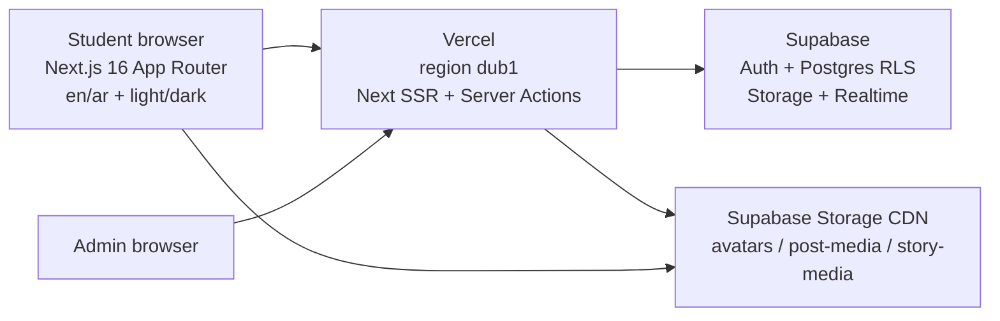
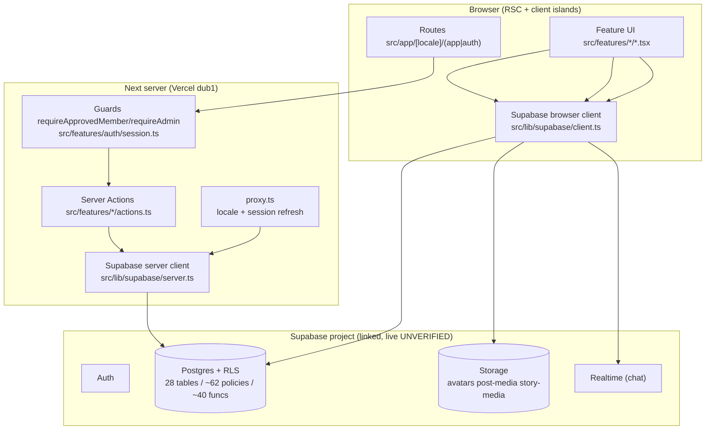
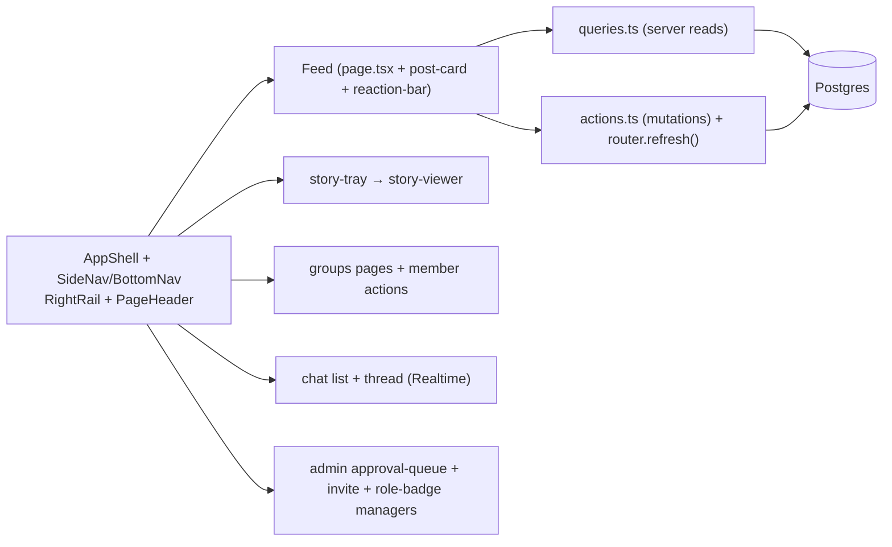
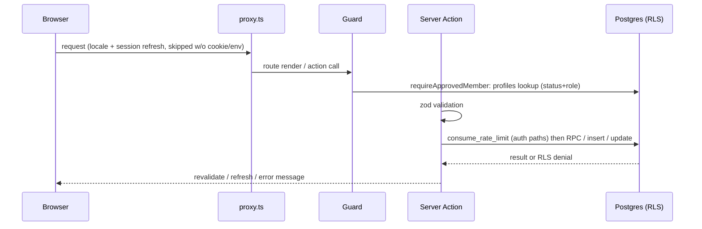
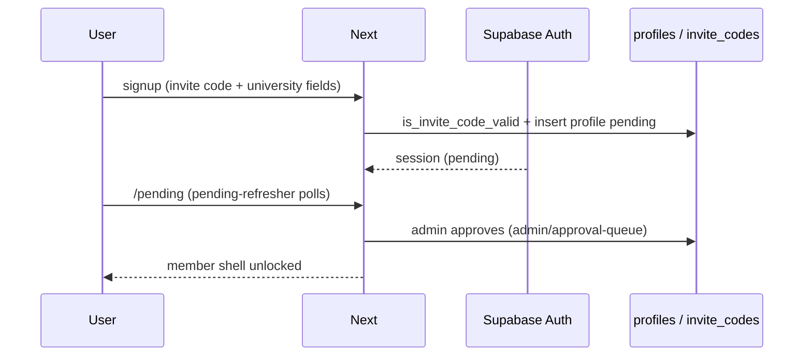
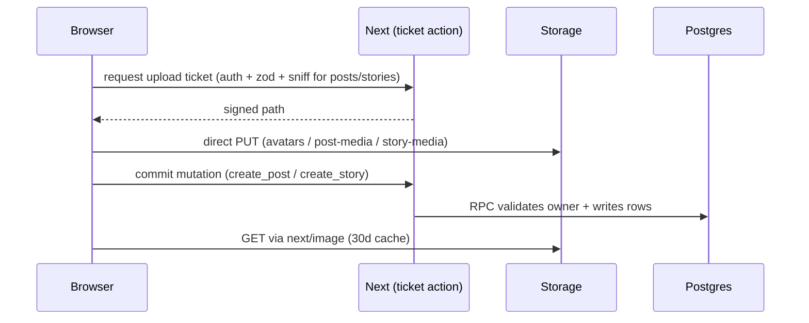
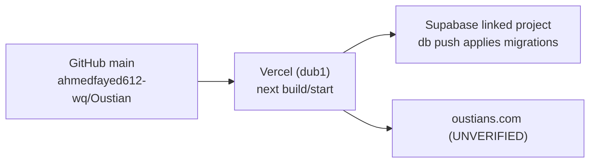

# Architecture — Oustians (verified implementation)

## 1. System context

No other backend, queue, search, analytics, or payment service exists in code. Email delivery = Supabase Auth default (UNVERIFIED live).

## 2. Container / service architecture

## 3. Frontend component & data flow

Entry: `src/app/[locale]/layout.tsx` (html lang/dir, fonts, ThemeProvider, NextIntlClientProvider) → `(auth)` (login/signup/pending, outside shell) vs `(app)/layout.tsx` (member shell, `requireApprovedMember`) → `admin/layout.tsx` (`requireAdmin`). RSC `staleTimes.dynamic 30s` (`next.config.ts:63-66`); mutations invalidate via `router.refresh()`.

## 4. Backend request processing

DB logic lives in Postgres functions (`create_post`, `react_to_post`, `react_to_comment`, `create_story`, `view_story`, `delete_story`, `handle_new_*`, `set_connection`, `ensure_connection_conversation`, `create_presentation_group`, `invite_to_presentation_group`, `respond_presentation_group_invitation`, `leave_presentation_group`, `set_user_role_verification`, …) — see DATABASE_REFERENCE.

## 5. Auth & session sequence

OAuth, MFA, email verification, custom recovery UI: NOT FOUND.

## 6. Media upload & delivery

Avatar path has NO server byte-sniff (SEC-001). Story publish does sniff (fixed in `367be1f`). Expiry = read-time filter (`expires_at > now()`), no cron (see stories section).

## 7. Deployment architecture

CI/CD workflow diagram: NOT APPLICABLE — no pipeline exists (NOT FOUND). Deploy = manual `git push` → Vercel auto-build (inferred from hosting choice, UNVERIFIED live) + manual `supabase db push`.

## 8. Decisions & trade-offs (evidenced)

- Supabase-everything (no custom server) → fast campus app, but RLS + RPC correctness is the entire security boundary.
- Direct-to-storage uploads → no Vercel bandwidth, but ticket/sniff logic must be airtight (see SEC-001/002).
- Read-time story expiry → no cron ops, but relies on every query filtering + `purge_expired_stories()` being called (PARTIAL — no schedule).
- RSC 30s stale + refresh → snappy nav, live-enough feed; risk = stale admin queues (accepted).
- CSP deferred to M8 → current headers are baseline only.
