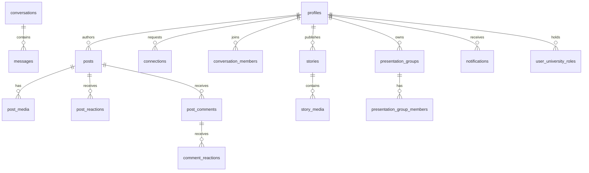

# Database Reference — Oustians (from 16 migrations, VERIFIED)

Engine: Supabase Postgres (server version UNVERIFIED). Access: `supabase-js@2.117.1` query builder, no ORM. Generated types: `src/lib/supabase/database.types.ts` (regenerate: `npm run db:types`).

## Tables (28)

| Table | Purpose | Key columns / constraints |
|---|---|---|
| `profiles` | Member identity; 1:1 `auth.users.id` | `id uuid PK FK`, `username citext UNIQUE`, `account_status` enum, `is_admin bool`, `university`, `major`, `avatar_path`, `is_private`, `language`; `protect_profile_columns()` blocks client `is_admin/status` writes |
| `invite_codes` / `invite_code_uses` | Campus gate | `code UNIQUE`, `max_uses/used_count`, `is_invite_code_valid()`; uses logged per user |
| `universities` / `university_subjects` / `university_roles` / `user_university_roles` / `user_role_audit_logs` | OUST taxonomy + verified badges | seed OUST; `set_user_role_verification()` admin-only; every change audit-logged |
| `posts` / `post_media` | Feed (text+photo; video cols per `29000000` UNVERIFIED live) | `author_id FK profiles`, `visibility`, `create_post()` RPC; media rows reference `post-media` paths |
| `post_likes` (legacy) / `post_reactions` / `comment_reactions` / `post_comments` | Likes + 4-type reactions (fire/insight/same/talk) + threaded comments | `UNIQUE(post,user,type)`; `react_to_post/comment()` RPCs; `ensure_comment_parent()`; triggers `after_post/comment_reaction` → notifications |
| `connections` | Requests/accept/block | `requester/addressee`, status; `set_connection()` + `handle_connection_request()`; accept auto-opens chat (`26110000`) |
| `conversations` / `conversation_members` / `messages` | 1:1 chat | `start_conversation()`, `ensure_connection_conversation()`, `list_conversation_previews()`, `handle_new_message()` → notification |
| `events` / `event_rsvps` | Campus events + RSVP | `handle_new_event/rsvp()` → notifications |
| `notifications` | Like/comment/message/rsvp/group notices | `maintain_reaction_notification()` recompute (`26000001`); read/unread per user |
| `stories` / `story_media` / `story_views` | 24h stories (photo+video) | `expires_at`, `create_story/view_story/delete_story`, `can_view_story[_object]`, `owns_story`; expiry enforced at READ time; `purge_expired_stories()` has NO schedule |
| `presentation_groups` / `presentation_group_members` / `presentation_group_invitations` | Subject groups, cap enforced | `create_presentation_group/invite/respond/leave` RPCs; capacity rule in `src/features/groups/capacity.ts` + unit test |
| `rate_limits` | Auth rate counters (hashed keys) | `consume_rate_limit()`; salt `RATE_LIMIT_SALT` |

## RLS (~62 policies) + storage

Per-op policies on all user tables; campus rule = approved members see approved content; owners manage own rows; admins via `is_admin()`/`is_approved_member()`. Storage buckets `avatars`, `post-media`, `story-media`: owner-write, member-read; story objects additionally gated by `can_view_story_object()`; owner-read repair `29000200`. Full per-policy dump = 62 lines; see migration files + `AUDIT_EVIDENCE_INDEX.md`.

## Functions (~40)

Listed in evidence index: auth helpers, post/story/group/connection/chat RPCs, notification triggers, `touch_updated_at`, `consume_rate_limit`, `purge_expired_stories`.

## ER (core)

## Integrity notes

- Uniqueness: invite codes, usernames, one-reaction-per-type, one-RSVP, one-view-per-story — VERIFIED in DDL.
- Cascades: child rows cascade off parents (profiles/posts/stories/groups) — VERIFIED pattern; orphan risk LOW.
- Missing: no FTS index (search uses `ilike` — full scan at scale); no purge cron (story tombstones accumulate); migration `29000000` statement-split was repaired (`9e41e55`) — re-verify on linked project before `db push`.
